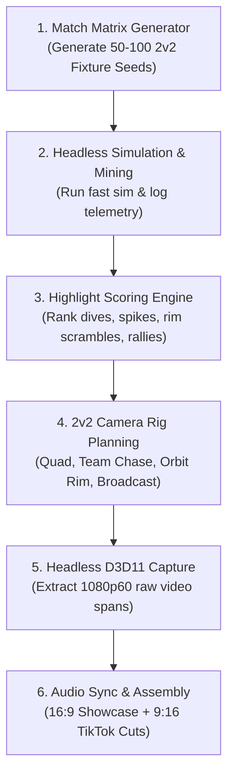

# Automated 2v2 Highlight Mining & Multi-Style Video Pipeline
*Execution Plan for Claude — Valleyball Versus v0.4.0 Video Production*

---

## 1. Objective & Overview

Build an automated pipeline that:
1. Simulates a **large batch of 2v2 matches (50–100 seeds)** across a diverse matrix of cosmetics (all 10 colorways, 3 physiques, 10 headgears) and game specs (1.5m Big Ball, 1.0m Valley Ball, 0.4m Foot Ball).
2. Parses in-engine match telemetry to **automatically detect and score top highlights** (aerial sets & spikes, clutch goal-line dives, multi-athlete rim scrambles, supersonic strikes).
3. Re-shoots selected highlight spans using **custom 2v2 camera rigs** in headless 1080p60 hardware Chromium.
4. Assembles both a **16:9 feature showcase (60–90s)** and **9:16 vertical shorts (15–30s)** synced to audio.

---

## 2. Existing Codebase Assets & Foundations

You do not need to build from scratch. The repository already contains a proven 1v1 harvesting pipeline in `media/blue-vs-red-reel/tools_v4/` that you can adapt for 2v2:

* `tools_v4/capture-gameplay.mjs`: Chromium hardware D3D11 headless render harness.
* `tools_v4/plan-reel.mjs`: Camera rig trajectory generator and interpolation planner.
* `tools_v4/render-reel.mjs`: Shot extractor and validation runner.
* `tools_v4/assemble-reel.mjs`: FFmpeg audio/video timeline assembler synced to musical BPM.
* `Valleyball-Versus-AI/src/features/match/matchManager.js`: Defines `TEAM_GROUPS` (`team1: [0, 2]`, `team2: [1, 3]`).
* `Valleyball-Versus-AI/scripts/play-fixture.mjs`: Playwright fixture execution runner.

---

## 3. Step-by-Step Execution Plan

### Step 1: 2v2 Match Matrix Generator (`scripts/mine-2v2-matrix.mjs`)
Create a generator that constructs 2v2 match fixture JSONs covering the full cosmetic and mechanics spectrum:
* **Ball Types**: 40% Standard (1.0m Valley Ball), 35% Big Ball (1.5m high-float), 25% Foot Ball (0.4m fast-striker).
* **Athletes Matrix (4 Slots: Slot 0 & 2 = Team 1, Slot 1 & 3 = Team 2)**:
  * **Colors**: Cycle all 10 canonical spectral colorways (Crimson, Azure, Gold, Emerald, Violet, Orange, Cyan, Magenta, White, Obsidian). Home vs Away must have high contrast.
  * **Physiques**: Randomly distribute `classic`, `masculine`, and `feminine` across the 4 slots.
  * **Headwear**: Assign distinct signature headgear to each athlete (e.g. `wrestler_bands`, `wicket_grill`, `captain_visor`, `ram_horns`, `beret`, `toki_crest`, `floral_crown`, `courier_cap`, `hachimaki`).
  * **AI Tuning**: Set difficulty to `hard` with aggressiveness varied between `0.65` and `0.95` for rapid, aggressive net play.
* Output: `captures/2v2_harvest/fixtures/fixture_seed_XXXX.json`.

### Step 2: Telemetry Scorer & Highlight Extractor (`scripts/score-2v2-highlights.mjs`)
Parse the telemetry outputs from the simulated runs and score events using this weighting system:

| Highlight Class | Detection Criteria | Priority Score |
| :--- | :--- | :--- |
| **Team Synergy (Pass & Spike)** | Slot 0 contacts ball, followed by Slot 2 aerial contact within 1.2s resulting in ball speed >20m/s | **100 pts** |
| **Rim Contest / Scramble** | 3 or 4 athletes within 3.0m radius of hoop ring during active ball descent | **85 pts** |
| **Clutch Dive Save** | Ground slide/dive contact within 0.4s of ball breaching the goal cylinder plane | **80 pts** |
| **Long Aerial Rally** | >= 5 consecutive volleys without the ball touching the turf or boundary | **75 pts** |
| **Supersonic Spike** | Strike exit velocity > 26.0 m/s towards the sloped walls or ring | **70 pts** |
| **Bank Rebound Goal** | Ball contacts sloped valley banked wall before cleanly sinking through ring | **65 pts** |

Filter down to the **top 15 highest-scoring moments** across all simulated games.

### Step 3: 2v2 Dynamic Camera Rigs (`scripts/plan-2v2-cams.mjs`)
Adapt `tools_v4/plan-reel.mjs` to incorporate camera perspectives tailored for 4 players:
1. **The 2v2 Quad-View Rig**: Simulates the in-game quad split-screen perspective during high-energy exchanges to show authentic local multiplayer.
2. **The Dynamic Team Chase Rig**: Smooth-follows the attacking teammate while keeping the setter and defender in the field of view.
3. **The Elevated Orbit Rim Rig**: Positioned at `(0, 14, ±38)` looking down through the torus ring as athletes contest for aerial rebounds.
4. **The Wide Broadcast Pan**: High-angle stadium crane sweeping along the coliseum axis to capture full court spacing and ball trajectory arcs.

### Step 4: Batch Render Runner (`scripts/render-2v2-reel.mjs`)
Execute Chromium hardware rendering using Playwright (matching `play-fixture.mjs` launch parameters):
* `--use-gl=angle`, `--use-angle=d3d11`
* `--enable-gpu-rasterization`, `--ignore-gpu-blocklist`
* Window size: `1920x1080` (or `1080x1920` native vertical crop).
* Record frame canvas buffers or native WebM/MP4 stream directly to disk.

### Step 5: FFmpeg Multi-Cut Assembly (`scripts/assemble-2v2-cuts.mjs`)
Build two distinct master cuts using FFmpeg:
1. **16:9 Showcase (60–75s)**:
   * **Intro (0–3s)**: High-speed rim clash / 4-way collision with loud impact SFX.
   * **Core (3–45s)**: Rapid montage of top 8 highlights, intercutting quad-split and broadcast views.
   * **Outro (45–60s)**: Team victory podium + Call-to-Action (*"Play v0.4.0 Free in Browser on itch.io · Championship Dec 27"*).
2. **9:16 TikTok / YouTube Shorts (15–25s)**:
   * Hook in first 1.5 seconds (*"When your teammate tackles you into the net instead of setting the ball"*).
   * 3 rapid-fire chaotic physics clips.
   * Bold center-screen subtitle cards.

---

## 4. Verification Checklist
- [ ] At least 3 different ball sizes featured across the clips.
- [ ] All 10 athlete colorways and multiple headgear items represented.
- [ ] 2v2 team coordination clearly visible (not just 1v1 action).
- [ ] Audio stems (game collisions, whistle, crowd, music) balanced so impacts hit hard.
